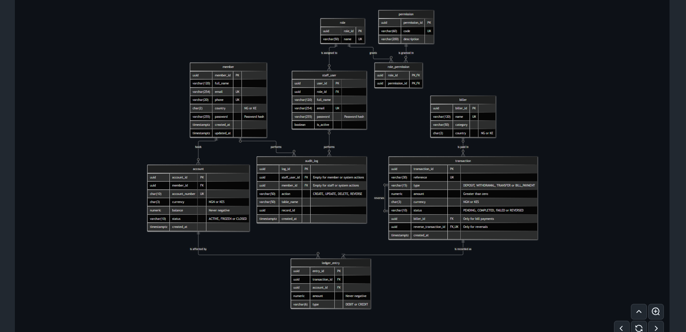

# MIT 8103 Advanced Database Systems: Portfolio Summary

**Star Bank** | Mathilda Imadojiemu | Student ID: 301834016

GitHub: [mahilday/Imadojiemu_Mathilda_301834016_advanced_db_portfolio](https://github.com/mahilday/Imadojiemu_Mathilda_301834016_advanced_db_portfolio)

## Case study

Star Bank is a simulated digital microfinance bank operating in Nigeria and Kenya. It serves small business owners through a mobile application, offering savings accounts, transfers, bill payments and account statements. The database is used by members through the application, by developers, by auditors with read-only access, and by system administrators. It stores members, accounts, transactions, ledger entries, billers, staff users with roles and permissions, and an audit log. Its key operations are deposits, withdrawals, transfers, bill payments, reversing failed transactions and auditing account balances. All records are fictional. PostgreSQL holds the banking records; MongoDB holds a document version of the same data.

## Portfolio 1: Database Design and Modelling

The relational design has ten tables, built from 16 business rules. A transfer touches two accounts, so `ledger_entry` sits between `transaction` and `account`, with one debit or credit row per account affected. Every table has a UUID primary key. Foreign keys connect accounts to members, entries to transactions and accounts, and bill payments to billers. Unique constraints cover emails, phone numbers, account numbers and transaction references. Check constraints restrict countries, currencies, types and statuses, reject negative balances and zero amounts, and require a biller on bill payments only. A transaction can be reversed once, enforced by a unique self-referencing key.

The normalisation document takes a statement list through 1NF, 2NF and 3NF to reach these tables, and names three deliberate exceptions, including the stored account balance. The sample data loads without error, and 20 invalid statements, at least one for each rule that a constraint can enforce, are all rejected. A balance audit confirms every stored balance equals its ledger total.

Figure 1. The ten tables and their relationships. PK identifies a row, FK links tables and UK marks a unique value.

<!-- PAGE BREAK -->

## Portfolio 2: Query Processing and Optimisation

Seven queries answer questions the bank would ask: an account statement, money in and out per member, failed transactions, payments per biller, the balance audit, a running balance using a window function, and reversals using a self-join. A separate table of 200,000 generated transactions is used for the speed test, leaving the banking records unchanged.

The test query summarises one day's completed transactions by type. It returns the same four rows, covering 266 transactions, before and after a B-tree index on `created_at`. `EXPLAIN (ANALYZE, BUFFERS)` records each plan. Three measured runs in each phase give:

| Measurement           | Before index      | After index |
| --------------------- | ----------------- | ----------- |
| Scan                  | Parallel Seq Scan | Index Scan  |
| Median execution time | 20.084 ms         | 0.326 ms    |
| Shared buffer hits    | 2,489             | 8           |

The index lets PostgreSQL go straight to the 288 rows for that day instead of reading all 200,000. Execution times varied between runs, from 15.137 ms to 57.576 ms before the index, while the buffer count did not, so the buffer count is the more reliable measure. The index also costs storage and slows inserts slightly.

## Portfolio 3: Transactions and Concurrency

A transfer of 1,000 NGN is saved with `COMMIT`: five changes succeed together and the combined balance of the two accounts is unchanged. A transfer of 50,000 NGN from an account holding 34,000 is then attempted. The debit is rejected by the balance check constraint, and `ROLLBACK` removes the transaction row, both ledger entries and the credit already applied.

Two sessions then run at `READ COMMITTED` against an account holding 28,000 NGN. Session A withdraws 20,000 without committing. Session B still reads 28,000, because uncommitted changes are invisible to it, and tries to withdraw 15,000. Its update waits on the row lock, which `pg_stat_activity` confirms. After A commits, B's update continues against the new balance of 8,000 and is rejected by the check constraint, so B rolls back. The final balance is 8,000 with one withdrawal recorded, and the balance audit still passes. The row lock and the constraint together prevented an overdraft that neither session could have detected alone.

## Portfolio 4: NoSQL and Advanced Data Models

MongoDB stores the same members and transactions in two collections. Accounts are embedded in their member, and ledger entries in their transaction, so a statement needs no joins. A `details` field holds different information for each transaction type, such as a meter number for an electricity payment. Validation rules and unique indexes restore the main Portfolio 1 rules.

The script loads 4 members and 10 transactions. Its statement query returns the same five transactions as the PostgreSQL query, and an aggregation over the embedded entries gives the same balances as the Portfolio 1 audit. Three invalid inserts are rejected. The document model suits statements, activity feeds and audit history. It is weaker for moving money, because balances sit in separate documents and copied data, such as a biller's name, is not kept in step. PostgreSQL therefore remains the system of record.

<!-- PAGE BREAK -->

## Portfolio 5: Distributed and Cloud Database Exercise

The design proposes a three-member replica set for each database. A primary accepts writes and secondaries copy them. If the primary fails, the remaining majority elects a replacement within seconds. Money movements are confirmed only when a majority of members hold them, and a member that cannot reach a majority refuses writes. Star Bank therefore gives up some availability in a serious outage to avoid recording conflicting balances.

This is a proposed design: no replica set, sharding or failover experiment was implemented.

A three-member replica set was run in Docker to test replication, failover and the refusal of writes without a majority; sharding and cloud deployment are proposed, not implemented.

## Evidence

Scripts, explanations, outputs and screenshots: [P1 design and tests](REPO/tree/main/portfolio-1-database-design), [P2 queries, plans and timings](REPO/tree/main/portfolio-2-query-optimisation), [P3 transactions](REPO/tree/main/portfolio-3-transaction-concurrency), [P4 document model](REPO/tree/main/portfolio-4-no-sql), [P5 design](REPO/tree/main/portfolio-5-distributed-cloud). Screenshots from Portfolios 1 and 2 record the database before Portfolio 3 changed two account balances.

## Individual reflection

The design choice I would defend most is the ledger entry table. Treating a transfer as one transaction with two entries made the balance audit a simple query and gave the concurrency work something real to protect. The part I found hardest was normalisation: I understood one value per cell, but 2NF and 3NF only made sense when I stopped reading definitions and asked, for each column, what actually decides its value.

In Portfolio 3 my first attempt at the two-session test failed because I ran Session A's whole file, which committed before Session B started. A committed transaction cannot be rolled back, so I had to remove the test rows and run it again. Repeating it one block at a time taught me that the order of steps across sessions is the whole point of the exercise. The timing results also surprised me: one run took 57 ms when the others took 15 to 20, with identical buffer counts, which showed me why a single timing proves little. In portfolio 4 and 5, I realized the best way to properly architect the DB for Star Bank is to use both NoSql and Relational DB that is geo-distributed since the data is across 2 countries (Nigeria and Kenya).

*Limit*

One limit I would like to remove is in the performance test. My real tables held too few rows for an index to matter, so I measured on a separate 200,000 row table that had no constraints or foreign keys. That showed the index working, but not how it behaves on the full schema, where a statement query joins three tables and every insert must also pass the constraint checks. With more time I would generate a large dataset that satisfies the whole schema and repeat the measurements there.

## References

[1] PostgreSQL Global Development Group. PostgreSQL Documentation: Constraints. https://www.postgresql.org/docs/current/ddl-constraints.html

[2] PostgreSQL Global Development Group. PostgreSQL Documentation: Using EXPLAIN. https://www.postgresql.org/docs/current/using-explain.html

[3] PostgreSQL Global Development Group. PostgreSQL Documentation: Transaction Isolation. https://www.postgresql.org/docs/current/transaction-iso.html

[4] MongoDB. Data Modeling in MongoDB. https://www.mongodb.com/docs/manual/data-modeling/

[5] MongoDB. Replication. https://www.mongodb.com/docs/manual/replication/

[6] MongoDB. Sharding. https://www.mongodb.com/docs/manual/sharding/

All banking data is fictional; the benchmark records are generated by the saved SQL.

## AI-use declaration

I used Claude (Anthropic) for sample data generation and confirmation of processes within this portfolio. I chose the case study and its scope, wrote the first versions of the case study description and the table schemas, and made the design decisions. I executed every script myself in pgAdmin, Docker and mongosh, compared the results with what was expected, and corrected errors I found, including constraint syntax errors, a broken table order, and a failed first run of the concurrency test.
