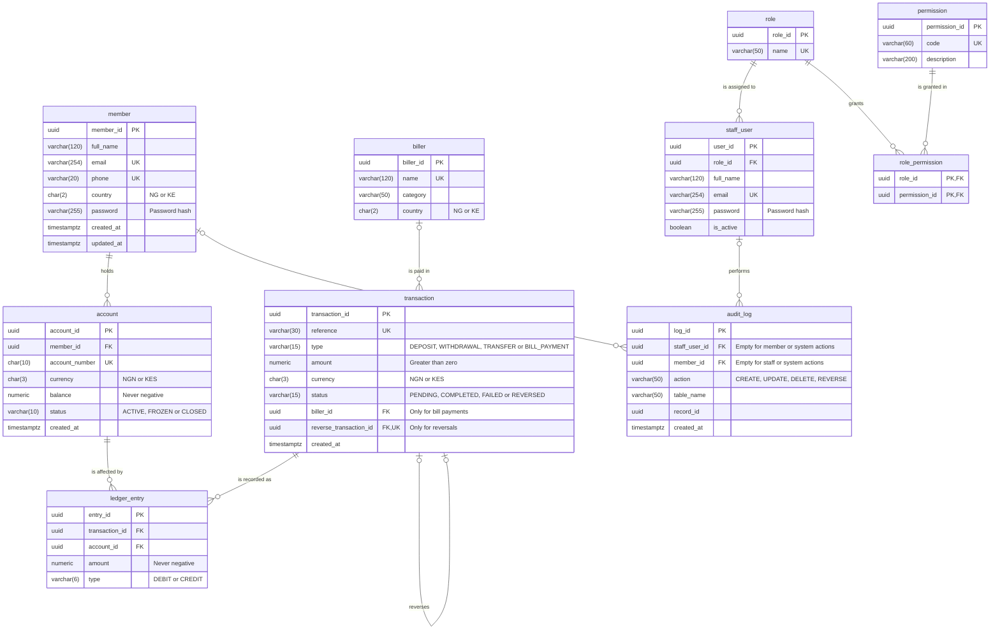

# ER DIAGRAM - STAR BANK

## Important Diagram Interpretation Satisfying Business Rules

- **PK** identifies one record. **FK** links to another table. **UK** means a value is unique.
- `||` means exactly one. `o|` means zero or one. `o{` means zero or many. `|{` means one or many.
- A member can hold zero or many accounts. Each account belongs to one member. (BR3)
- A transaction is recorded as one or many ledger entries. Each entry belongs to one transaction and affects one account. (BR10)
- An account can be affected by zero or many ledger entries over time.
- A biller can be paid in zero or many transactions. A transaction refers to a biller only when it is a BILL_PAYMENT. (BR13)
- A transaction can reverse at most one earlier transaction, and a transaction can be reversed at most once. (BR12)
- Each staff user has exactly one role. A role can be assigned to zero or many staff users. (BR14)
- Roles and permissions are many-to-many, linked through role_permission. (BR15)
- Every audit log record is linked to the staff user or member who performed the action, or to neither when the system acted. (BR16)

The diagram below shows the relationships within all entities in this case study

**Examples: An important take-away**

*Scenario*

1. *Member transferring from account A to account B:*

This would require one transaction and two ledger entries (one for CREDIT on B and another for DEBIT on A), both amounts need to be the exact same which shows transparency, consistency and balance keeping.

2. *Member depositing into account A*:

This requires one transaction and 1 ledger entry (CREDIT to account A).

