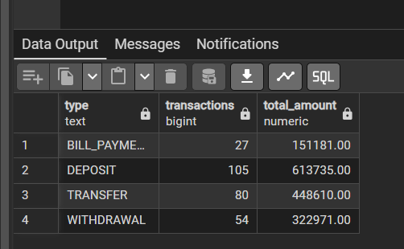

# Portfolio 2: Query Processing and Optimization

This portfolio uses the Star Bank database from Portfolio 1. It has two parts: business queries run against the real tables, and one optimization experiment run against a larger test table.

## How this was implemented and tested

- **Database:** PostgreSQL, accessed through the pgAdmin Query Tool, database `star_bank`.
- **Business queries:** run against the Portfolio 1 tables and sample data. Each result was checked against the sample data by hand.
- **Optimization experiment:** run against a separate test table of 200,000 generated rows in its own schema, `performance_p2_test`, so the Portfolio 1 tables are not changed.
- **Method:** the same query was measured with `EXPLAIN (ANALYZE, BUFFERS)` before and after adding one index. Each measurement was run four times; the first run was ignored and the next three recorded as evidence.

### Run order

1. Portfolio 1 schema and sample data (already in place).
2. [Queries](Imadojiemu_Mathilda_301834016_Queries.sql): run each query on its own.
3. [Optimization](Imadojiemu_Mathilda_301834016_Optimizations.sql): run one block at a time, in order.

## Part 1: Business queries

| # | Question it answers | SQL features used |
| --- | --- | --- |
| Q1 | What has happened on this account? | Three-table join, sorting |
| Q2 | How much has each member paid in and paid out? | Joins, `LEFT JOIN`, `GROUP BY`, filtered aggregates |
| Q3 | Which transactions failed or are still pending? | Filtering with `IN` |
| Q4 | How much has each biller received? | `LEFT JOIN` to keep billers with no payments, aggregates |
| Q5 | Do the stored balances agree with the ledger? | `LEFT JOIN`, `CASE`, aggregate comparison |
| Q6 | What was the balance after each entry? | Window function (`SUM … OVER`) |
| Q7 | Which transactions were reversed, and by what? | Self-join |

Q5 is the "audit account balances" operation from the case study, and Q7 supports "reverse failed transactions".

Q6 orders entries by reference because the sample rows share one timestamp. In a live system it would order by `created_at`.

### Screenshots

| Rows returned | Result |
| --- | --- |
| 5 | [Query_Result](screenshots/Imadojiemu_Mathilda_301834016_Query_Result.png) |
| 4 | [Query_Result](screenshots/Imadojiemu_Mathilda_301834016_Query_Result_1.png) |

## Part 2: Optimization experiment

### Why a separate test table

The Portfolio 1 sample data has 10 transactions. On a table that small, PostgreSQL reads every row almost instantly and has no reason to use an index, so an index would show no measurable benefit. The experiment therefore uses `performance_p2_test.transaction_history`, a test table with the same kind of columns as `transaction`, filled with 200,000 generated rows.

Every value is calculated from the row number, so the data is identical on every run. Rows are dated 5 minutes apart from 1 January 2024, which gives exactly 288 rows per day.

### The query under test

A daily summary: for 1 January 2025, the number and total value of completed transactions of each type.

```sql
SELECT type, count(*) AS transactions, sum(amount) AS total_amount
FROM performance_p2_test.transaction_history
WHERE created_at >= TIMESTAMPTZ '2025-01-01 00:00:00+00'
  AND created_at <  TIMESTAMPTZ '2025-01-02 00:00:00+00'
  AND status = 'COMPLETED'
GROUP BY type
ORDER BY type;
```


It returns 4 rows covering 266 completed transactions. The result was the same before and after the index.

### The change

One B-tree index on the column the query filters by. Nothing else was changed.

```sql
CREATE INDEX transaction_history_created_at_idx
    ON performance_p2_test.transaction_history (created_at);
```

### Results

| Measure | Before index | After index |
| --- | --- | --- |
| Scan type | Parallel Seq Scan | Index Scan using `transaction_history_created_at_idx` |
| Rows removed by filter | 99,867 per process (about 199,734 in total) | 22 |
| Buffers (shared hit) | 2,489 | 8 |
| Execution time, reading 1 (ms) | 57.576 | 0.326 |
| Execution time, reading 2 (ms) | 15.137 | 0.290 |
| Execution time, reading 3 (ms) | 20.084 | 0.698 |
| Average (ms) | 30.932 | 0.438 |
| Median (ms) | 20.084 | 0.326 |


### Performance analysis

A test table was generated to contain 200,000 rows of data that is based on the star bank schema for the transactions table

Note: The star bank transaction table remains unchanged

1. **Before the index**: The whole table was read (around 199,734 at least discarded) since they did not match, this ran for approximately 31ms.
2. **After the index** the plan shows an index scan. The date conditions moved from the `Filter` line to the `Index Cond` line, which shows the index was used to find the rows, the average execution time for this is 0.438ms which shows a massive above 80% percent drop in time taken to filter through rows.
3. The 22 rows still removed are the failed and pending transactions on that day. The index covers dates only, so `status` is checked afterwards.
4. Pages read fell from 2,489 to 8, and the execution time fell by the factor shown in the table.

### Limits of this experiment

- The test table is a stand-in for `transaction`. It has no foreign keys or constraints.
- The data is evenly spaced in time. Real transactions cluster at busy hours.
- Timings are from one laptop and will differ on other machines. The scan type and buffer counts are the more reliable comparison.

## Evidence

| Required evidence | File |
| --- | --- |
| Execution plans | [Before](screenshots/Imadojiemu_Mathilda_301834016_Before_Index_Add.png), [After](screenshots/Imadojiemu_Mathilda_301834016_After_Index.png) |
| SQL queries | [Queries](Imadojiemu_Mathilda_301834016_Queries.sql) |
| Query results | Screenshots Q1 to Q7, listed above |
| Indexing / optimization evidence | [Optimization](Imadojiemu_Mathilda_301834016_Optimization.sql) |
| Performance analysis | [Analysis](#performance-analysis) |

### Screenshots

| Screenshot | What it shows |
| --- | --- |
| [Test_Row_Count](screenshots/Imadojiemu_Mathilda_301834016_Total_Test_Rows.png) | 200,000 rows in the test table |
| [Day_Row_Count](screenshots/Imadojiemu_Mathilda_301834016_Count_Per_Day.png) | 288 rows on the chosen day |
| [Summary_Result](screenshots/Imadojiemu_Mathilda_301834016_Return_Daily_Count.png) | The daily summary result |
| [Plan_Before](screenshots/Imadojiemu_Mathilda_301834016_Before_Index_Add.png) | Execution plan before the index |
| [Index_Creation](screenshots/Imadojiemu_Mathilda_301834016_Add_Index.png) | The index being created |
| [Plan_After](screenshots/Imadojiemu_Mathilda_301834016_After_Index.png) | Execution plan after the index |